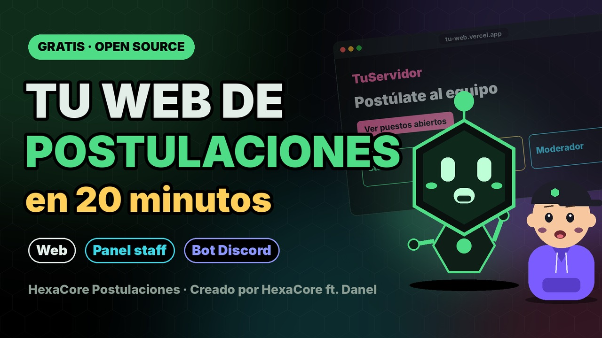

<div align="center">

# ⬡ HexaCore Postulaciones

**Sistema de postulaciones para comunidades de Discord: web + bot.**

Los aspirantes entran con Discord, responden el examen del puesto y reciben la respuesta por MD.
El staff revisa, comenta y decide desde un panel. Tú solo pones tu nombre, tu logo y tus colores.

**Creado por HexaCore ft. Danel** · Discord: `danel100816`

### 🎬 Tutorial en vídeo: configúralo en 20 minutos

[](https://youtu.be/ZO3gBsXz8hM)

**[▶ Ver el tutorial en YouTube](https://youtu.be/ZO3gBsXz8hM)** · ⭐ Si te sirve, deja una estrella al repo

</div>

---

## Qué incluye

- **Web** (Next.js 15, Tailwind 4, NextAuth con Discord, Prisma + PostgreSQL), lista para Vercel.
  - Portada con los puestos abiertos y cerrados.
  - Examen de una pregunta cada vez, con borrador automático, atajos de teclado y resumen antes de enviar.
  - Cuatro tipos de pregunta: texto corto, texto largo, verdadero/falso y opción única. Pueden llevar respuesta correcta e imagen o vídeo de YouTube/Vimeo.
  - Cada aspirante sigue su postulación con una línea de tiempo y ve el motivo si se rechaza.
  - **Panel staff** para revisar, aprobar o rechazar con motivo, dejar notas internas y ver el historial de cada aspirante.
  - **Editor de formularios** para crear puestos, ordenar preguntas arrastrando, abrir y cerrar categorías, fijar el tiempo de espera para volver a postular y el rol que se da al aprobar.
  - Permisos por roles de Discord (Reviewer y Admin), límite de intentos contra spam y cabeceras de seguridad.
- **Bot de Discord** (discord.js 14).
  - Manda MD al aspirante en cada cambio de estado.
  - Da el rol del puesto al aprobar.
  - Registra todo en un canal de staff.
  - Publica el panel con `/postulaciones`.
  - No guarda nada: la web es la única fuente de verdad.

## Estructura

```
HexaCore-Postulaciones/
├─ web/                 La web (despliégala en Vercel con Root Directory = web)
│  ├─ src/config/marca.ts   ← TU MARCA: nombre, textos y colores
│  ├─ public/logo.png       ← TU LOGO
│  ├─ src/app/icon.png      ← icono de la pestaña
│  ├─ prisma/setup.sql      Crea la base de datos (Supabase → SQL Editor)
│  └─ .env.example          Variables de la web
├─ bot/                 El bot (Discloud, VPS…)
│  └─ .env.example          Variables del bot
├─ LICENSE              Licencia (léela: créditos obligatorios)
└─ NOTICE.md            Autoría
```

## Puesta en marcha (unos 20 minutos)

> 🎬 ¿Prefieres verlo? Todo este apartado está explicado en el [vídeo tutorial](https://youtu.be/ZO3gBsXz8hM).

### 1. Tu marca
1. Edita `web/src/config/marca.ts`: nombre, textos de la portada y colores.
2. Cambia `web/public/logo.png` por tu logo (cuadrado, PNG transparente, 512×512) y `web/src/app/icon.png` por tu icono.
3. En el bot, pon `BRAND_NAME` y `BRAND_COLOR` en su `.env`.

### 2. Base de datos (Supabase, gratis)
1. Crea un proyecto en [supabase.com](https://supabase.com).
2. Abre **SQL Editor → New query**, pega todo `web/prisma/setup.sql` y pulsa **Run**. Crea las tablas, la protección contra spam y dos puestos de ejemplo (cerrados).

### 3. Aplicación de Discord
En el [Developer Portal](https://discord.com/developers/applications), crea una aplicación. La misma sirve para la web y para el bot.
1. **OAuth2 → Redirects**: añade `https://TU-WEB/api/auth/callback/discord` (y `http://localhost:3000/api/auth/callback/discord` si vas a probar en local).
2. Copia el **Client ID** y el **Client Secret**.
3. **Bot → Reset Token**: copia el token. En **Privileged Gateway Intents**, activa **Server Members Intent**.
4. Invita el bot a tu servidor con permisos para gestionar roles y enviar mensajes. Su rol tiene que estar **por encima** de los roles que vaya a dar.
5. Activa el modo desarrollador de Discord y copia los IDs del servidor, del rol Reviewer, del rol Admin y del canal de registro.

### 4. Web en Vercel
1. Haz un fork de este repositorio (o descárgalo) y en [vercel.com/new](https://vercel.com/new) impórtalo.
2. **Root Directory = `web`**.
3. **Storage → Supabase → Connect**: crea solas `POSTGRES_PRISMA_URL` y `POSTGRES_URL_NON_POOLING`.
4. Añade el resto de variables de `web/.env.example`:

   | Variable | Qué es |
   |---|---|
   | `NEXTAUTH_URL` | La URL final de tu web, sin barra al final |
   | `NEXTAUTH_SECRET` | Un texto aleatorio largo (`openssl rand -base64 32`) |
   | `DISCORD_CLIENT_ID` / `DISCORD_CLIENT_SECRET` | De OAuth2 |
   | `DISCORD_GUILD_ID` | ID de tu servidor |
   | `DISCORD_BOT_TOKEN` | Token del bot (recomendado) |
   | `REVIEWER_ROLE_ID` / `ADMIN_ROLE_ID` | Quién revisa y quién además edita formularios |
   | `MEMBER_ROLE_ID` | Opcional: solo quien lo tenga puede postular |
   | `NEXT_PUBLIC_DISCORD_INVITE` | Invitación a tu Discord |
   | `BOT_API_SECRET` | Secreto compartido con el bot (`openssl rand -hex 32`) |

5. **Deploy**. Después abre `https://TU-WEB/api/health`: te dice qué falta, sin enseñar ningún secreto.

### 5. Bot
1. En `bot/`, copia `.env.example` a `.env` y rellénalo. `WEB_URL` y `BOT_API_SECRET` tienen que coincidir con la web.
2. **Discloud**: comprime el contenido de `bot/` (sin `node_modules`) y súbelo. **VPS**: `npm install && npm start`.
3. En tu Discord, escribe `/postulaciones` en el canal donde quieras el panel.

### 6. Listo
Entra en la web con una cuenta que tenga el rol Admin, ve a **Formularios**, edita los puestos y ábrelos.

## Probar en local

```bash
cd web
cp .env.example .env    # rellénalo
npm install
npm run dev             # http://localhost:3000
```

## Errores típicos

| Síntoma | Causa |
|---|---|
| El login vuelve con `error=OAuthCallback` | El redirect de Discord no coincide exactamente con `NEXTAUTH_URL/api/auth/callback/discord`, o el Client Secret está mal |
| `error=Configuration` | Falta `NEXTAUTH_SECRET` o `DISCORD_CLIENT_SECRET` |
| "No te encontramos en el Discord" | `DISCORD_GUILD_ID` incorrecto |
| No ves el panel staff | `REVIEWER_ROLE_ID` / `ADMIN_ROLE_ID` vacíos o con otro ID |
| El bot dice `401` | `BOT_API_SECRET` distinto en la web y en el bot (mínimo 16 caracteres) |
| El bot no da el rol | Su rol está por debajo del rol que intenta dar |

## Licencia y créditos

Este proyecto **no es de dominio público**. Usa la [Licencia HexaCore de Uso con Atribución](LICENSE):

- ✅ **Gratis** para tu comunidad. Puedes cambiar el nombre, el logo, los colores y los formularios, y adaptar el código.
- ❌ **No** puedes venderlo, republicarlo en otros sitios ni presentarlo como obra tuya.
- 🔒 **Créditos obligatorios**: el pie "Creado por HexaCore ft. Danel" de la web y el de los mensajes del bot no se pueden quitar, ocultar ni cambiar. La compilación comprueba que siguen ahí.

¿Necesitas otro tipo de uso? Escríbeme por Discord: **`danel100816`**, o a traves de **`https://discord.gg/5XTgECZvyZ`**.

---

<div align="center">

**HexaCore Postulaciones** · Creado por **HexaCore ft. Danel** · © 2026

</div>
